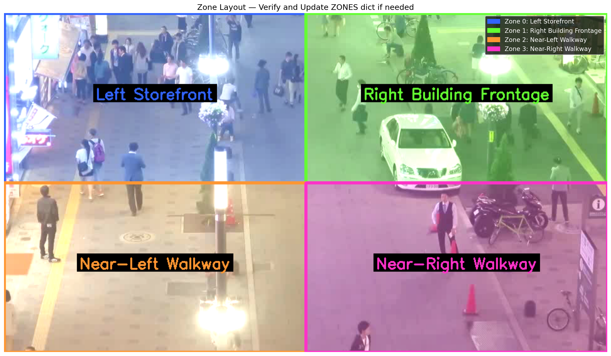
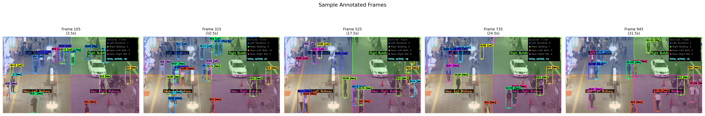
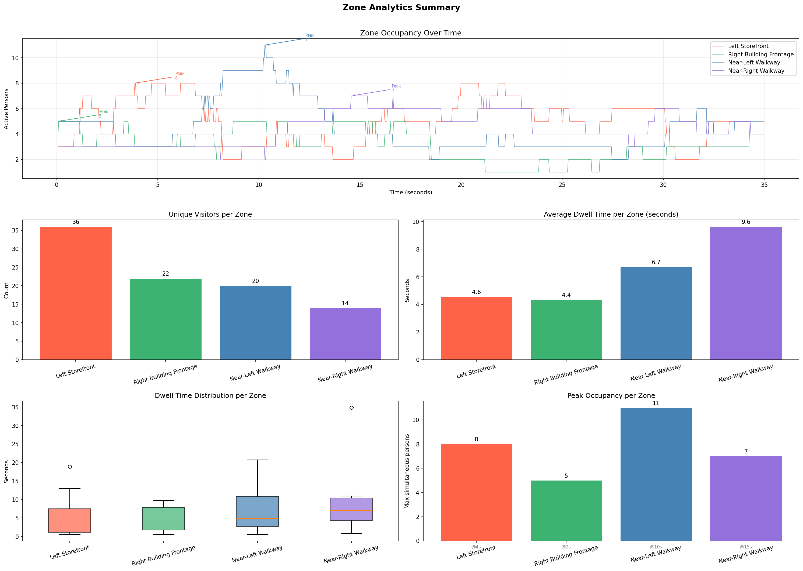

# Real-Time People Tracking and Zone-Based Occupancy Analytics

This project tracks people in a video with YOLOv8 and DeepSORT, assigns each tracked person to one of four manually defined zones, and turns the results into zone-level occupancy analytics. The final output includes an annotated video, structured summary files, and a frame-by-frame occupancy log.

## What the project does

The pipeline is split into five phases. The analytics run uses the `MOT17-04-FRCNN` sequence (1050 frames, 30 fps, 960×540) as its default input. `MOT17-02-FRCNN` is included as an additional validation sequence.

1. **Detection & Tracking** - YOLOv8 detects people and DeepSORT keeps persistent track IDs across frames.
2. **Zone Definition** - Four zones are drawn on the first frame as equal quadrant polygons.
3. **Analytics** - The project measures live occupancy, unique visitors, dwell time, and peak occupancy for every zone.
4. **Visualization** - Annotated video and summary charts are generated.
5. **Validation** - Tracker performance is evaluated against MOT17 ground truth using standard `motmetrics`.

Run the notebooks in order: `Phase1.ipynb` → `Phase2.ipynb` → `Phase3.ipynb` → `Phase4.ipynb`. `Phase5.ipynb` is the standalone validation step.

### Main dependencies

- `ultralytics`
- `deep_sort_realtime`
- `supervision` *(required for Phase1_ByteTrack.ipynb)*
- `opencv-python`
- `numpy`
- `pandas`
- `matplotlib`
- `motmetrics` *(required for Phase5.ipynb - install in a separate environment)*

## Using the MOT17 dataset

MOT17 is distributed as numbered JPEG frames, but MOTChallenge also provides
raw MP4 exports for each sequence. This workspace uses the downloaded
`MOT17-04-FRCNN` video by default. Both `MOT17-02-FRCNN` and `MOT17-04-FRCNN`
are saved in `data/MOT17/videos/`.

The raw MP4 exports are 960×540, whereas the corresponding MOT17 annotations
use 1920×1080 coordinates. Phase5.ipynb handles this automatically: it
multiplies hypothesis coordinates by a scale factor of 2.0 on each axis before
evaluating predictions generated from the 960×540 MP4 files. Fullres runs
(1920×1080) use a scale factor of 1.0 and need no adjustment.

The MOT17 data itself is ignored by Git (`data/MOT17/`) to avoid committing
the large dataset.

## Phase 1 - Detection & Tracking

For detection, **YOLOv8-Large** (`notebooks/yolov8l.pt`) is used and filtered
to the person class only (`class 0`). For tracking, **DeepSORT** keeps each
person's ID stable across frames.

The tracker settings were chosen to keep IDs stable in a moderately crowded scene:

| Parameter | Value |
| --- | --- |
| `max_age` | 30 |
| `n_init` | 3 |
| `max_cosine_distance` | 0.30 |
| `max_iou_distance` | 0.70 |
| Embedder | MobileNet (CPU) |
| Confidence threshold | 0.40 |
| IoU threshold (NMS) | 0.45 |

Why these values:

- `max_age=30` lets a track survive short occlusions without being dropped too quickly.
- `n_init=3` avoids confirming noisy detections too early.
- `max_iou_distance=0.70` keeps the association rule permissive enough for moving people.
- `max_cosine_distance=0.30` preserves identity using appearance features when motion alone is not enough.

The analytics run (MOT17-04-FRCNN, 960×540, DeepSORT) produced **59 unique track IDs** and an estimated **39 proxy ID-gap events**. Note that this proxy metric is not equivalent to the standard MOTChallenge IDSW metric; genuine IDSW values are computed in Phase 5 using ground-truth matching.

A comparison run using **ByteTrack** is provided in `Phase1_ByteTrack.ipynb`. ByteTrack uses IoU-only association (no appearance embeddings) with the `supervision` library.

## Phase 2 - Zone Definition

Four zones are defined directly on the first frame as equal quadrant partitions
of the 960×540 frame (each zone covers 480×270 pixels):

| Zone | Name | Top-Left | Bottom-Right |
| --- | --- | --- | --- |
| Zone 0 | Left Storefront | (0, 0) | (480, 270) |
| Zone 1 | Right Building Frontage | (480, 0) | (960, 270) |
| Zone 2 | Near-Left Walkway | (0, 270) | (480, 540) |
| Zone 3 | Near-Right Walkway | (480, 270) | (960, 540) |

Zone membership is determined from the tracked person's **centroid** - the centre point of the bounding box. The zones are non-overlapping, so every point belongs to at most one zone. Points outside all zones are assigned zone `-1`.

### Labeled zone layout



## Phase 3 - Analytics

For each zone, the project computes:

- **Live occupancy count** - number of unique track IDs in the zone on each frame
- **Total unique visitors** - distinct track IDs that appeared in the zone at least once
- **Total entries** - number of zone-entry events per track
- **Average dwell time** - mean time spent per continuous visit segment
- **Peak occupancy** and the frame/timestamp when it occurred

### Final zone summary

Results from the MOT17-04-FRCNN analytics run (960×540, DeepSORT, conf=0.40):

| Zone | Name | Unique Visitors | Total Entries | Avg Dwell (s) | Max Dwell (s) | Peak Occupancy | Peak Time (s) |
| --- | --- | ---: | ---: | ---: | ---: | ---: | ---: |
| 0 | Left Storefront | 28 | 30 | 4.68 | 18.33 | 7 | 6.333 |
| 1 | Right Building Frontage | 23 | 25 | 5.17 | 13.70 | 6 | 13.667 |
| 2 | Near-Left Walkway | 18 | 24 | 6.37 | 19.47 | 10 | 8.267 |
| 3 | Near-Right Walkway | 13 | 15 | 10.12 | 34.90 | 7 | 14.700 |

The full machine-readable results are saved in:

- `outputs/analytics/zone_analytics.csv`
- `outputs/analytics/zone_analytics.json`
- `outputs/analytics/frame_occupancy_log.csv`
- `outputs/analytics/tracks_with_zones.json`
- `outputs/analytics/zones.json`

### Sample occupancy log

The frame-level log records the occupancy of every zone on every processed frame (1048 rows, frames 2–1049). A few representative rows:

| Frame | Time (s) | Zone 0 | Zone 1 | Zone 2 | Zone 3 |
| --- | ---: | ---: | ---: | ---: | ---: |
| 2 | 0.067 | - | - | - | - |
| 190 | 6.333 | **7** | - | - | - |
| 248 | 8.267 | - | - | **10** | - |
| 410 | 13.667 | - | **6** | - | - |
| 441 | 14.700 | - | - | - | **7** |

*(Bold = peak occupancy frame for that zone.)*

## Phase 5 - MOT17 Validation

Tracker output is evaluated against MOT17 ground truth using the `motmetrics`
library. Six configurations are compared across two sequences.
Ground-truth boxes are filtered to pedestrian class (class 1) with visibility > 0.1.
The evaluation IoU matching threshold is 0.5.

### Validation results

| Sequence | Config | MOTA | MOTP | IDF1 | IDSW | Recall | Precision |
| --- | --- | ---: | ---: | ---: | ---: | ---: | ---: |
| MOT17-04 | Fullres ByteTrack | **30.46%** | 14.31% | 44.90% | 20 | 32.50% | 94.19% |
| MOT17-04 | Conf=0.25 | 29.32% | 14.12% | 41.37% | 45 | 31.65% | 93.93% |
| MOT17-04 | Baseline (960×540) | 27.67% | 13.91% | 40.06% | 42 | 30.08% | 93.73% |
| MOT17-02 | Fullres ByteTrack | 21.86% | 15.65% | 32.17% | 48 | 25.43% | 88.28% |
| MOT17-02 | Baseline (960×540) | 16.34% | 14.93% | 27.73% | 44 | 18.63% | 90.43% |
| MOT17-02 | Conf=0.25 | 13.60% | 14.65% | 24.83% | 53 | 15.35% | 91.84% |

MOTA formula: `MOTA = 1 − (FN + FP + IDSW) / GT_count`

The best overall result is **MOTA = 30.46%** (MOT17-04, 1920×1080, ByteTrack).

## Output examples

### Annotated frames



### Analytics summary chart



### Additional diagnostics

- `outputs/analytics/phase1_track_stats.png` - tracking statistics (track count, duration distribution)
- `outputs/analytics/zone_heatmaps.png` - spatial density per zone
- `outputs/analytics/first_frame.png` - initial frame used for zone drafting

The final annotated videos are saved as:

- `outputs/videos/final_annotated.mp4`
- `outputs/videos/phase1_tracked.mp4`

## Parameter choices

| Choice | Value | Reason |
| --- | --- | --- |
| YOLO model | YOLOv8-Large (`yolov8l.pt`) | Stronger recall in dense scenes |
| Person-only filtering | `class=0` | Reduces false positives |
| Confidence threshold | 0.40 | Balances recall vs. noise |
| DeepSORT `max_age` | 30 | Keeps IDs through short occlusions |
| DeepSORT `n_init` | 3 | Avoids confirming single-frame noise |
| Cosine distance | 0.30 | Tight appearance gate for ID stability |
| Centroid zone assignment | bbox centre | Simple and consistent; equal quadrant zones make boundary ambiguity rare |

## Challenges faced and how I handled them

**ID stability** - In crowded moments, people overlap and the detector can
briefly lose a person or swap identities. Using DeepSORT with appearance
embeddings, a 30-frame track buffer, and a 3-hit confirmation threshold reduces
this. A ByteTrack comparison run is also included.

**Zone boundary flicker** - A person near a zone edge can oscillate between
zones across consecutive frames. The equal quadrant partition and centroid-based
assignment minimise ambiguity. Because the zones do not overlap, no priority
rule is needed.

**Resolution mismatch in validation** - MOT17 annotation coordinates are
1920×1080, but the MP4 videos are 960×540. Phase5.ipynb applies a 2× scale
factor to hypothesis coordinates before matching against ground truth.

## Repository structure

```text
notebooks/
  Phase1.ipynb              # DeepSORT tracking pipeline
  Phase1_ByteTrack.ipynb    # ByteTrack comparison
  Phase2.ipynb              # Zone definition and assignment
  Phase3.ipynb              # Zone analytics
  Phase4.ipynb              # Visualization and annotated video
  Phase5.ipynb              # MOT17 validation
  Setup_Extract_MOT_Data.ipynb
  yolov8l.pt
  yolov8m.pt
outputs/
  analytics/                # JSON, CSV, PNG analytics outputs
  validation/               # MOT17 hypothesis files and evaluation CSV
  videos/                   # Annotated MP4 outputs
data/
  MOT17/                    # Git-ignored; download separately
```

## Notes

The sample outputs in this repository were generated from MOT17-04-FRCNN at
960×540 with DeepSORT (conf=0.40) and saved under `outputs/`. If you rerun the
notebooks with a different video or configuration, the analytics files and images
will update accordingly. Validation results in Phase 5 cover all six
sequence/configuration combinations listed in the table above.

## License

This project is licensed under the [MIT License](LICENSE) — see the [LICENSE](LICENSE) file for details.

